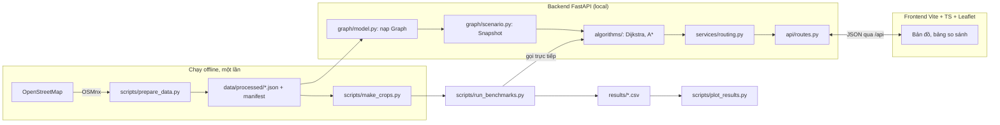

# SaiGo — Kiến trúc

Nhãn **[Đã chốt] / [Đề xuất] / [Giả định]** theo [PROJECT_BRIEF.md](PROJECT_BRIEF.md). Chi tiết cấu trúc dữ liệu ở [DATA_MODEL.md](DATA_MODEL.md).

## 1. Tổng quan



Ba ý chính:

1. **Thuật toán là hàm thuần.** `algorithms/` không import FastAPI, OSMnx hay Leaflet. Có thể test và benchmark mà không cần server.
2. **Dữ liệu tải một lần.** Sau bước offline, app chỉ đọc JSON. Demo chạy được khi không có Internet.
3. **Benchmark không đi qua HTTP.** Đo đúng thời gian thuật toán, không lẫn thời gian mạng hay vẽ bản đồ.

## 2. Công nghệ

| Thành phần | Chọn | Lý do ngắn gọn | Thay thế đã cân nhắc |
|---|---|---|---|
| Ngôn ngữ thuật toán | Python 3.11, `heapq`, `dataclasses` | Nhóm quen; `heapq` là binary heap chuẩn; code đọc giống pseudocode | C++ nhanh hơn nhưng khó giải thích, khó tích hợp |
| Tải dữ liệu đường | OSMnx (chỉ trong `scripts/`) | Tải mạng đường có hướng từ OSM, giữ đường một chiều, cạnh song song `(u,v,key)` | Overpass API thủ công: tốn công, dễ sai |
| Đối chứng | NetworkX (chỉ trong `tests/`) | Có `dijkstra_path_length` đáng tin để so chi phí | — |
| Backend | FastAPI + uvicorn | Đã có trong khung; schema Pydantic kiểm tra input | Flask: phải tự validate |
| Frontend | TypeScript thuần + Vite + Leaflet | Đã có trong khung; Leaflet đủ cho polyline/marker; không cần React (D6) | React: thêm thứ phải học |
| Test | pytest | Đã có trong khung và CI | — |
| Biểu đồ | Matplotlib | Xuất PNG/SVG cho essay và slide | — |
| Lưu trữ | File JSON/CSV | Không cần database; dữ liệu chỉ đọc | SQLite: thừa |
| Chạy trên Windows | Lệnh trong README (2 terminal) | PDF không yêu cầu `.exe` (D8) | PyInstaller: rủi ro với thư viện geospatial |

**Môi trường [Đề xuất]:** `pip install -e ".[dev]"` cho app/test; `pip install -e ".[data]"` cho OSMnx. Nếu OSMnx cài lỗi trên Windows, tạo môi trường conda-forge riêng chỉ để chạy `prepare_data.py` (D9). Khóa phiên bản (`pip freeze > requirements.lock`) sau task T00/T02.

## 3. Cấu trúc module (dự kiến)

Thư mục đã có trong khung; file mới được tạo dần theo [TASKS.md](TASKS.md).

```text
backend/app/
  graph/
    model.py         Graph, GraphMeta, load_graph(), kiểm tra khi nạp        (T01, T30)
    geo.py           haversine_m(), trung điểm polyline, khoảng cách tới vùng (T10)
    scenario.py      Scenario, Snapshot, build_snapshot()                    (T40)
    closures.py      tìm cạnh đối, nhóm "đóng đoạn"                          (T41)
    snap.py          nearest_node() trong SCC, ngưỡng 150 m                 (T50)
  algorithms/
    result.py        SearchResult, dựng lại tuyến từ predecessor edge         (T11)
    dijkstra.py      dijkstra()                                              (T11)
    astar.py         astar()                                                 (T20)
    heuristics.py    make_geo_heuristic(), compute_c(), zero_heuristic       (T20, T22)
    tour.py          tour_cost, nearest_neighbor, two_opt, held_karp         (E1: T70, T71)
  services/
    routing.py       route_request() → chạy Dijkstra/A*, đo thời gian, gói kết quả (T51)
    tour.py          cost matrix + tour (E1: T72)
  api/
    schemas.py       Pydantic request/response
    routes.py        /health, /dataset, /network, /route, (/tour)
  cli.py             python -m app.cli route|check-heuristic ...             (T12)
  main.py            nạp Graph khi khởi động (lifespan), gắn router

scripts/
  prepare_data.py    OSM → JSON + manifest                                   (T30)
  make_crops.py      cắt lồng nhau cho thí nghiệm tăng quy mô                (T61)
  run_benchmarks.py  sinh truy vấn có seed, đo, ghi results/                 (T60, T62, T63)
  plot_results.py    biểu đồ                                                  (T64)

tests/
  fixtures/mini.json ví dụ 6 node ở DATA_MODEL mục 7
  test_graph_model.py, test_geo.py, test_dijkstra.py, test_astar.py,
  test_oracle_networkx.py, test_scenario.py, test_snap.py, test_api_route.py,
  test_tour.py (E1)

frontend/src/
  main.ts            khởi tạo bản đồ, gắn panel
  api.ts             gọi /api, kiểu dữ liệu response
  layers.ts          vẽ mạng đường, tuyến, node đã mở rộng, vùng ùn tắc, cạnh đóng
  panel.ts           bảng điều khiển + bảng kết quả

data/
  config/            areas.json, speeds.json, scenarios.json
  demo/cases.json    case demo đã kiểm tra
  processed/         JSON đồ thị (gitignored), manifest.json (commit)
results/             <run_id>/queries.csv, measurements.csv, env.json
```

## 4. API [Đề xuất]

| Method | Path | Vai trò | Task |
|---|---|---|---|
| GET | `/api/health` | Server sống, đã nạp dataset chưa | Có sẵn; cập nhật ở T51 |
| GET | `/api/dataset` | `dataset_id`, vùng, số node/cạnh, danh sách kịch bản | T51 |
| GET | `/api/network` | GeoJSON các cạnh của vùng demo (có `edge_id`) | T32 |
| POST | `/api/route` | Tìm đường giữa hai điểm | T51 |
| POST | `/api/tour` | Tour nhiều điểm (E1) | T72 |

Ví dụ request/response của `/api/route`:

```json
{
  "source": {"lat": 10.7725, "lon": 106.6980},
  "target": {"lat": 10.7801, "lon": 106.6990},
  "algorithms": ["dijkstra", "astar"],
  "scenario_id": "baseline",
  "blocked_edge_ids": [],
  "trace_limit": 5000
}
```

```json
{
  "dataset_id": "hcm-benthanh-r2000-20261025",
  "snapshot_id": "a1b2c3",
  "snapped": {
    "source": {"node_id": 812, "lat": 10.77251, "lon": 106.69795, "snap_distance_m": 8.1},
    "target": {"node_id": 1440, "lat": 10.78005, "lon": 106.69911, "snap_distance_m": 12.7}
  },
  "results": {
    "dijkstra": {"status": "ok", "cost_s": 0, "distance_m": 0, "edge_ids": [],
                 "geometry": {"type": "LineString", "coordinates": []},
                 "expanded": 0, "runtime_ms": 0, "trace": [], "trace_truncated": false},
    "astar":    {"...": "cùng cấu trúc"}
  },
  "costs_match": true,
  "warnings": []
}
```

Các số trong ví dụ chỉ để minh họa cấu trúc, **không phải kết quả**. `costs_match` là `|cost_dijkstra − cost_astar| ≤ 1e-6 · max(1, cost_dijkstra)`.

Lỗi: tọa độ ngoài vùng hoặc snap > 150 m → 422 với thông báo tiếng Việt; `blocked_edge_ids` không tồn tại → 422.

## 5. Luồng một request `/api/route`

1. Pydantic kiểm tra dữ liệu vào.
2. `snap.nearest_node()` cho nguồn và đích (chỉ node thuộc SCC).
3. `scenario.build_snapshot(graph, scenario_id, blocked_edge_ids)`.
4. Với mỗi thuật toán: đo `perf_counter_ns()` quanh `dijkstra()`/`astar()`.
5. Gắn geometry từ `GraphMeta` theo `edge_ids`; chuyển `trace` (node id) thành tọa độ.
6. Trả JSON. Không lưu trạng thái giữa các request.

## 6. Giao diện

Giữ bố cục 3 cột ở [DEMO.md](DEMO.md) mục 1 (bảng điều khiển / bản đồ / kết quả), nhưng **bản MVP chạy chế độ tìm đường hai điểm trước**; chế độ tour chỉ thêm ở E2.

| Lớp bản đồ | Nội dung |
|---|---|
| Nền | Tile OSM khi có mạng (chỉ xem tương tác, có ghi nguồn; không tải hàng loạt). Khi offline: chỉ lớp mạng đường từ `/api/network` |
| Mạng đường | Polyline mảnh, vẽ bằng Canvas (`preferCanvas: true`) |
| Tuyến Dijkstra / A* | Hai màu; nếu trùng nhau thì vẽ một nét có viền |
| Node đã mở rộng | Chấm nhỏ, mỗi thuật toán một màu; nhãn "K node mở rộng đầu tiên" khi `trace_truncated` |
| Vùng ùn tắc | Vòng tròn/polygon tô mờ khi chọn kịch bản |
| Cạnh đóng | Đỏ, nét đứt |

Nhãn bắt buộc: "Thời gian di chuyển ước tính (theo kịch bản)" tách biệt với "Thời gian tính toán"; không dùng một chữ "Time" chung.

**Rủi ro hiển thị:** vùng demo có thể có hàng chục nghìn cạnh. Phải đo thời gian vẽ trên laptop demo ở T32. Nếu chậm thì thu nhỏ vùng demo; đồ thị lớn của thí nghiệm tăng quy mô chỉ chạy offline, không vẽ.

## 7. Kiểm thử

| Mức | Nội dung | Chạy ở |
|---|---|---|
| Unit | Graph loader, haversine, Dijkstra/A* trên `mini.json`, scenario, snap | CI + local |
| Đối chứng | Đồ thị ngẫu nhiên có tọa độ (seed cố định): so chi phí và `no_path` với NetworkX | CI + local |
| Dữ liệu thật | 200 cặp ngẫu nhiên trên đồ thị thật, so với NetworkX | Local (không có trong CI vì file lớn) |
| API | TestClient với fixture nhỏ | CI |
| Thủ công | Checklist UI trong PROGRESS.md | Local, trước mỗi mốc |

CI không tải OSM và không cần file JSON lớn.
