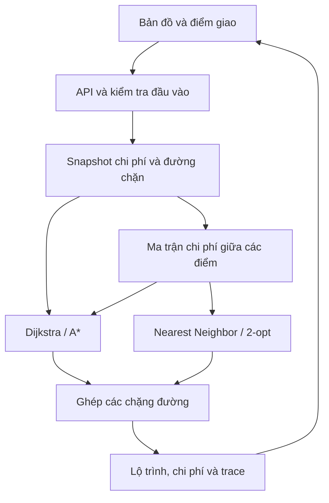

# SaiGo — Tài liệu mô tả đề tài và định hướng triển khai

**Tên tiếng Anh:** SaiGo: Delivery Route Planning on Ho Chi Minh City Street Networks Using Heuristic Search  
**Tên tiếng Việt:** SaiGo: Lập kế hoạch lộ trình giao hàng trên mạng đường TP.HCM bằng tìm kiếm heuristic  
**Học phần:** Introduction to AI — 261_72ITSE30303_01  
**Giảng viên:** Dr. Huy T. Nguyen  
**Nhóm:** Nhóm 4 — Võ Việt Tiến, Bùi Duy Anh, Đỗ Quốc Bảo, Võ Hoàng Minh  
**Phiên bản tài liệu:** 1.0 — ngày 01/10/2026  
**Trạng thái:** Đặc tả đề xuất; chưa phải báo cáo kết quả thực nghiệm.

> Tài liệu này phục vụ đăng ký, thuyết trình proposal, phân công và triển khai đồ án. Các mục tiêu, cấu hình và ngưỡng đề xuất cần được xác nhận bằng thực nghiệm. Không sử dụng các ví dụ hoặc ô kết quả chưa đo làm thành tích của nhóm.

## Mục lục

1. Tổng quan và ý nghĩa tên SaiGo
2. Liên hệ với yêu cầu của giảng viên
3. Vấn đề, người dùng và tình huống sử dụng
4. Mục tiêu và câu hỏi nghiên cứu
5. Phạm vi bắt buộc và phần mở rộng
6. Mô hình toán học và giả định
7. Dữ liệu mạng đường và tiền xử lý
8. Mô hình thời gian di chuyển và giao thông mô phỏng
9. Thuật toán tìm đường
10. Tối ưu thứ tự giao nhiều điểm
11. Chặn đường và lập lại lộ trình
12. Yêu cầu chức năng và tiêu chí nghiệm thu
13. Giao diện và trải nghiệm sử dụng
14. Kiến trúc và công nghệ
15. Đề xuất API và cấu trúc dữ liệu
16. Cấu trúc repository
17. Kiểm thử tính đúng đắn
18. Thiết kế thực nghiệm và benchmark
19. Kịch bản demo và thuyết trình
20. Kế hoạch thực hiện và phân công
21. Báo cáo, đầu ra và định hướng portfolio
22. Rủi ro, giới hạn và hướng mở rộng
23. Hướng dẫn làm việc với AI coding
24. Nội dung đăng ký tiếng Anh
25. Tài liệu tham khảo

---

## 1. Tổng quan và ý nghĩa tên SaiGo

### 1.1. Ý nghĩa tên

**SaiGo** ghép từ **Sài Gòn** và **Go**, gợi việc di chuyển trong thành phố. Đây là tên làm việc của dự án, chưa được kiểm tra tính độc quyền thương hiệu hoặc tên miền.

- Tên sản phẩm: **SaiGo**.
- Tên repository gợi ý: **saigo** hoặc **saigo-route-planner**.
- Thông điệp gợi ý: **Chọn đường hợp lý, giao hàng hiệu quả.**

### 1.2. Mô tả ngắn

SaiGo là ứng dụng bản đồ giúp lập kế hoạch giao hàng cho một shipper trên một khu vực giới hạn của TP.HCM. Người dùng chọn kho và các điểm giao; chương trình tìm đường trên mạng đường thực, cải thiện thứ tự ghé các điểm và tính lại lộ trình khi một đoạn đường bị chặn.

Phần nghiên cứu tập trung vào so sánh thuật toán tìm kiếm và chất lượng lộ trình. Sản phẩm sử dụng **dữ liệu đường phố thực** nhưng **thời gian di chuyển và giao thông được mô phỏng**. Không tuyên bố cung cấp ETA giao thông trực tiếp hoặc khả năng điều hướng thương mại.

### 1.3. Một ví dụ dễ hình dung

Một shipper xuất phát từ kho và phải giao 5 đơn trong khu vực nghiên cứu. Nếu đi theo thứ tự đơn được nhập, người đó có thể đi vòng hoặc quay lại một khu vực nhiều lần. SaiGo so sánh thứ tự ban đầu với thứ tự được cải thiện, vẽ các chặng đường và trình bày tổng thời gian ước tính theo mô hình.

Người dùng đánh dấu một đoạn đường trên lộ trình là không thể đi qua. SaiGo tính lại các chặng bị ảnh hưởng và thứ tự giao khi cần, đồng thời giải thích nếu có điểm không còn tiếp cận được.

## 2. Liên hệ với yêu cầu của giảng viên

### 2.1. Hướng đề tài

SaiGo thuộc **Category 1: Intelligent Agents & Problem Solving**, hướng **Pathfinding in Complex Environments**. PDF đề cập việc triển khai, so sánh tìm kiếm trên bản đồ phức tạp, trong đó có ví dụ bản đồ thành phố với giao thông; tìm kiếm cục bộ và vật cản động cũng phù hợp các hướng được nêu.

Nội dung **Chapter 9: Machine Learning** của Nhóm 4 là bài thuyết trình lý thuyết trong lớp, không dùng làm giới hạn cho topic đồ án này.

### 2.2. Yêu cầu được ghi trong PDF

| Hạng mục | Yêu cầu |
|---|---|
| Đầu ra học thuật | Written essay và oral presentation |
| Độ dài essay | 10 trang, không tính trang bìa |
| Định dạng | Double spaced |
| Trang bìa | Tên đề tài, tên và mã số sinh viên của các thành viên |
| Cấu trúc | Introduction, discussion, conclusion rõ ràng |
| Chứng minh dài | Trình bày phác thảo và có trích dẫn đầy đủ |
| Thuyết trình cuối kỳ | 15 phút |
| Tính nguyên bản | Tự triển khai, trích dẫn nguồn, không sao chép bài của nhóm khác |

**Mốc dự kiến trong PDF:**

| Ngày | Mốc |
|---|---|
| 10/09/2026 | Đăng ký nhóm và topic |
| 02/10/2026 | Proposal presentation — 10 phút |
| 12/11/2026 | Last lecture, final ready |
| 19/11/2026 | Oral presentation — 15 phút |
| 22/11/2026 | ETC submission |

Các mốc được ghi là **tentative**; nhóm theo dõi thông báo cập nhật của giảng viên. Tài liệu này không suy diễn ra một rubric chấm điểm chưa được cung cấp.

Ảnh bảng đăng ký có ví dụ delivery gồm report, source code và executable chạy trên Windows. PDF không quy định rõ mọi nhóm phải nộp `.exe`; nhóm chuẩn bị ứng dụng chạy local trên Windows và chỉ cam kết executable sau khi kiểm tra đóng gói thành công.

### 2.3. Đóng góp nhóm cần thể hiện

1. Mô hình hóa bài toán tìm kiếm trên mạng đường có hướng.
2. Tự cài đặt Dijkstra và A*, giải thích heuristic và điều kiện đúng.
3. Tự cài đặt Nearest Neighbor và 2-opt cho thứ tự giao hàng.
4. Kiểm thử, thực nghiệm và phân tích đánh đổi.
5. Xây dựng bản demo thể hiện được các thuật toán trên dữ liệu thực.

## 3. Vấn đề, người dùng và tình huống sử dụng

### 3.1. Vấn đề cần giải quyết

- Đường ngắn nhất theo quãng đường có thể không có thời gian di chuyển nhỏ nhất theo mô hình.
- Thứ tự nhận đơn chưa chắc tạo ra một hành trình hiệu quả.
- Đường một chiều làm chi phí đi và về khác nhau.
- Một đoạn đường bị chặn có thể khiến tuyến hiện tại mất tính hợp lệ.
- Người học khó quan sát khác biệt giữa tìm kiếm không heuristic và tìm kiếm có heuristic trên dữ liệu đường phố.

### 3.2. Người dùng mục tiêu

| Người dùng | Nhu cầu trong phạm vi demo |
|---|---|
| Người lập kế hoạch giao hàng | Chọn kho, điểm giao, xem thứ tự ghé và lộ trình |
| Sinh viên học AI | Quan sát và so sánh Dijkstra/A* |
| Giảng viên/người đánh giá | Kiểm tra phần tự triển khai và kết quả thực nghiệm |

Không cần đăng nhập, quản lý khách hàng, thanh toán hoặc hệ thống đơn hàng thật để hoàn thành đồ án.

### 3.3. Tình huống tiêu biểu

- **UC01:** Chọn hai điểm và tìm đường có thời gian nhỏ nhất theo một kịch bản.
- **UC02:** Chọn kho và nhiều điểm giao; xem hành trình theo thứ tự nhập.
- **UC03:** Cải thiện thứ tự giao bằng Nearest Neighbor rồi 2-opt.
- **UC04:** Thay đổi kịch bản giao thông, tính lại và so sánh.
- **UC05:** Chặn một đoạn đường; tìm đường tránh và kiểm tra các điểm còn tiếp cận được.
- **UC06:** Chạy một bộ truy vấn cố định để so sánh thuật toán.

## 4. Mục tiêu và câu hỏi nghiên cứu

### 4.1. Mục tiêu tổng quát

Thiết kế một hệ thống lập kế hoạch lộ trình có thể kiểm chứng, minh họa cách tìm kiếm heuristic và tìm kiếm cục bộ giải quyết hai tầng của bài toán giao hàng trên mạng đường thực.

### 4.2. Mục tiêu cụ thể

| Mã | Mục tiêu | Bằng chứng hoàn thành |
|---|---|---|
| G01 | Tải và chuẩn hóa mạng đường một khu vực TP.HCM | Dataset snapshot, manifest, báo cáo số nút/cạnh |
| G02 | Tìm đường đúng bằng Dijkstra và A* | Kiểm thử đối chứng về chi phí và tính hợp lệ |
| G03 | Đánh giá heuristic | Benchmark số nút mở rộng và thời gian |
| G04 | Cải thiện thứ tự giao hàng | Chi phí trước/sau, kiểm tra không bỏ sót điểm |
| G05 | Xử lý đường bị chặn | Test đường một chiều, cạnh song song và không có đường |
| G06 | Demo có thể tái lập | Dữ liệu mẫu, hướng dẫn chạy local, thao tác demo cố định |

### 4.3. Câu hỏi nghiên cứu

**RQ1 — Tìm đường:** A* với cận dưới địa lý về thời gian có giảm số nút mở rộng và thời gian truy vấn so với Dijkstra trên mạng đường đã chọn không?

**RQ2 — Thứ tự giao:** Nearest Neighbor kết hợp 2-opt cải thiện tổng thời gian hành trình thế nào so với thứ tự nhập và Nearest Neighbor đơn lẻ?

**RQ3 — Kịch bản:** Tăng chi phí hoặc chặn đường ảnh hưởng thế nào đến tính khả thi, chi phí hành trình và thời gian lập lại kế hoạch?

**RQ4 — Mở rộng ALT:** Nếu làm ALT, chất lượng cận dưới và tốc độ truy vấn thay đổi ra sao theo số landmark, và lợi ích có xứng đáng với tiền xử lý/bộ nhớ không?

Không đặt trước kết luận rằng A* luôn nhanh hơn hoặc 2-opt luôn tìm tối ưu toàn cục. Báo cáo phải phản ánh cả trường hợp không cải thiện.

## 5. Phạm vi bắt buộc và phần mở rộng

### 5.1. Phạm vi cam kết

| Hạng mục | Quyết định đề xuất |
|---|---|
| Khu vực | Một polygon/bounding box giới hạn tại TP.HCM; có vùng đệm dữ liệu |
| Phương tiện | Mô hình một shipper trên mạng đường được lựa chọn và công bố |
| Số shipper | 1 |
| Điểm giao trên UI | Mục tiêu ban đầu 5–15 điểm; giới hạn xác nhận sau benchmark |
| Hành trình nhiều điểm | Xuất phát và quay về kho |
| Tìm đường | Dijkstra và A* tự cài đặt |
| Thứ tự giao | Thứ tự nhập → Nearest Neighbor → 2-opt |
| Giao thông | Các snapshot chi phí mô phỏng, cố định trong mỗi lần truy vấn |
| Vật cản | Người dùng chặn cạnh hoặc nhóm cạnh của đoạn đường |
| Giao diện | Bản đồ tương tác, lộ trình, so sánh thuật toán |
| Thực nghiệm | Bộ truy vấn cố định và các bộ điểm giao nhỏ |
| Cách chạy chính | Local trên Windows; bản web là đầu ra bổ sung nếu triển khai ổn |

### 5.2. Mở rộng theo thứ tự ưu tiên

1. **ALT:** thêm một heuristic dựa trên landmark và đánh giá tiền xử lý.
2. **Simulated Annealing:** so sánh với 2-opt dưới cùng ngân sách thời gian.
3. **Bidirectional Dijkstra hoặc bidirectional A*:** chỉ bổ sung khi hiểu và kiểm chứng điều kiện dừng.
4. **Hành trình không quay về kho:** chốt rõ đầu/cuối và điều chỉnh phép tối ưu.
5. **Giới hạn thời gian giao hoặc nhiều shipper:** hướng phát triển sau đồ án.

Không cam kết đồng thời tất cả phần mở rộng trong proposal.

### 5.3. Ngoài phạm vi bản đầu

- Giao thông, ngập và GPS trực tiếp.
- Dự báo kẹt xe bằng machine learning.
- Theo dõi shipper đang di chuyển ngoài thực tế.
- VRP có tải trọng, nhiều xe, time windows hoặc pickup–delivery.
- Turn-by-turn navigation, đầy đủ quy tắc rẽ, cấm rẽ và mọi hạn chế phương tiện.
- Cam kết ETA đúng với chuyến đi thật.

## 6. Mô hình toán học và giả định

### 6.1. Mạng đường

Biểu diễn mạng đường bằng đồ thị có hướng:

\[
G=(V,E)
\]

- `V`: các nút của mạng đường, thường đại diện giao lộ hoặc đầu đoạn sau xử lý dữ liệu.
- `E`: các cạnh có hướng đại diện đoạn đường có thể di chuyển theo mô hình.
- `w_s(e)`: thời gian ước tính của cạnh `e` trong snapshot `s`, tính bằng giây.
- Trọng số cạnh có thể đi phải hữu hạn và không âm; tốc độ phải dương.
- Cạnh bị chặn được loại khỏi tập cạnh có thể mở rộng của snapshot.

Trong dữ liệu gốc, nhận diện cạnh bằng `(u, v, key)` để phân biệt cạnh song song. Adapter thuật toán phải giữ danh tính cạnh, không chỉ giữ cặp nút.

### 6.2. Bài toán hai điểm

Với nguồn `a` và đích `b`, tìm đường `P` tối thiểu hóa:

\[
C_s(P)=\sum_{e\in P}w_s(e)
\]

Nếu không có đường có hướng hợp lệ, trả kết quả không tìm thấy đường. Không trả đường thẳng trên bản đồ thay cho một tuyến đường hợp lệ.

### 6.3. Bài toán nhiều điểm

Cho kho `p0` và các điểm giao `p1…pn`. Tính ma trận:

\[
D_{ij}=d_s(p_i,p_j)
\]

Trong đó `d_s` là chi phí đường đi ngắn nhất trên cùng snapshot. Do đường một chiều, nhìn chung `Dij` khác `Dji`.

Chọn hoán vị các điểm giao để giảm tổng chi phí:

\[
D_{0,\pi_1}+\sum_{k=1}^{n-1}D_{\pi_k,\pi_{k+1}}+D_{\pi_n,0}
\]

Đây là phiên bản tour có hướng trên ma trận chi phí giữa các điểm giao. Quãng đường Euclidean giữa các địa chỉ không thay thế chi phí trên mạng đường.

### 6.4. Giả định của bản đầu

- Mỗi điểm giao được phục vụ đúng một lần theo danh sách dừng.
- Chuyến đi quay về kho; không có time window hoặc tải trọng.
- Thời gian phục vụ tại điểm giao được bỏ qua, hoặc cộng cùng một hằng số cho mọi phương án và công bố rõ.
- Chi phí cố định trong mỗi lần lập kế hoạch, không thay đổi theo thời điểm đến từng cạnh.
- Việc lộ trình đi ngang một điểm giao không tự động đồng nghĩa đã phục vụ điểm đó.
- Người dùng chọn vị trí đã được ánh xạ hợp lệ vào mạng đường.
- Đường tối ưu là tối ưu **trong mô hình và snapshot**, không phải bảo đảm hành trình thực tế nhanh nhất.

## 7. Dữ liệu mạng đường và tiền xử lý

### 7.1. Nguồn và khu vực

Sử dụng OpenStreetMap, tải bằng OSMnx. OSMnx hỗ trợ mạng đường có hướng và lưu/đọc GraphML; cấu trúc cạnh dùng `(u, v, key)` [R1].

Nhóm nên bắt đầu từ một vùng liên tục, có đặc điểm đường đủ đa dạng. Có thể chọn vùng quanh khu vực thường gọi là Quận 1, Quận 3 và mở rộng nếu cần. Chốt bằng polygon cụ thể để tái lập, không phụ thuộc vào một truy vấn tên hành chính có thể thay đổi.

Vùng tải dữ liệu nên có **buffer** ngoài vùng chọn điểm. Nếu cắt quá sát, tuyến hợp lý đi ra ngoài rồi quay vào sẽ bị mất. Báo cáo phải ghi đây vẫn là bài toán trên đồ thị đã trích xuất.

### 7.2. Quy trình đề xuất

1. Chốt polygon nghiên cứu, vùng đệm và ngày tải.
2. Chọn network filter và ghi rõ loại đường được giữ/loại.
3. Tải mạng đường; giữ chiều đi theo dữ liệu.
4. Kiểm tra thành phần liên thông và khả năng đi có hướng.
5. Kiểm tra `length`, tọa độ, geometry và đơn vị.
6. Gán hoặc suy đoán tốc độ theo cấu hình được công bố.
7. Tính chi phí cơ sở; tạo adjacency phù hợp thuật toán tự viết.
8. Lưu GraphML, geometry và manifest.
9. Tạo các truy vấn, bộ điểm giao và tình huống chặn đường cố định.

Không khẳng định filter `drive` tự động mô hình hóa đầy đủ mọi điều kiện di chuyển của xe máy. Phải xem việc chọn đường là một giả định được kiểm tra, và công bố các hạn chế chưa mô hình hóa.

### 7.3. Manifest dữ liệu

| Trường | Nội dung cần lưu |
|---|---|
| `dataset_id` | Tên snapshot duy nhất |
| `downloaded_at` | Ngày/giờ thu dữ liệu |
| `study_polygon` | Phạm vi chọn điểm giao |
| `download_polygon` | Phạm vi tải có vùng đệm |
| `network_filter` | Cấu hình loại đường |
| `simplification` | Cấu hình đơn giản hóa |
| `node_count`, `edge_count` | Số liệu đo sau tiền xử lý |
| `speed_config` | Tốc độ và cách xử lý giá trị thiếu |
| `graph_hash` | Hash của bản dữ liệu dùng thực nghiệm |
| `dependencies` | Phiên bản thư viện đã kiểm tra |
| `attribution` | Nguồn dữ liệu và thông tin giấy phép |

Không điền số nút/cạnh trước khi tải và thống kê.

### 7.4. Ánh xạ điểm trên bản đồ

- UI nhận tọa độ người dùng chọn và tìm nút phù hợp trên đồ thị.
- Hiển thị vị trí người dùng chọn cùng vị trí đã snap nếu hai điểm khác nhau đáng kể.
- Có ngưỡng khoảng cách snap cấu hình được; xác nhận ngưỡng sau thử nghiệm.
- Điểm ngoài vùng hoặc quá xa mạng đường phải có thông báo rõ.
- Nút gần nhất có thể nằm bên kia sông/cầu hoặc trên đường không phù hợp; kiểm tra những trường hợp này trong demo mẫu.
- Phiên bản đầu có thể snap về nút. Snap chính xác lên cạnh và tạo nút ảo là phần mở rộng.

### 7.5. Bản đồ offline và ghi nguồn

Lưu graph không đồng nghĩa đã có nền bản đồ offline. Cách đơn giản cho bản local là vẽ geometry mạng đường đã lưu thành lớp GeoJSON trên Leaflet và đóng gói JS/CSS cần thiết.

Nếu cần nền bản đồ đầy đủ, dùng dữ liệu tự render hoặc nhà cung cấp cho phép offline. Không tải hàng loạt tile từ `tile.openstreetmap.org` để dự trữ; chính sách tile chuẩn không cho cách dùng đó [R3].

Giao diện và tài liệu phải ghi nguồn OpenStreetMap. Khi phân phối dữ liệu, kiểm tra nghĩa vụ của ODbL và giấy phép các thành phần khác; không tự giả định giấy phép mã nguồn cũng bao phủ dataset [R4].

## 8. Mô hình thời gian di chuyển và giao thông mô phỏng

### 8.1. Chi phí cơ sở

Với chiều dài `L` tính bằng mét và tốc độ `v` tính bằng km/h:

\[
t_{base}(e)=\frac{L(e)}{v(e)/3.6}
\]

Tốc độ có thể lấy từ thuộc tính nguồn khi hợp lệ hoặc gán theo nhóm đường trong cấu hình. Tốc độ giới hạn/ước lượng không phải tốc độ thực đo của shipper.

Ví dụ dưới đây chỉ minh họa phép tính:

- Đoạn đường dài 600 m.
- Tốc độ giả định 30 km/h.
- Chi phí cơ sở: 72 giây.
- Hệ số kịch bản 1,5: chi phí 108 giây.

### 8.2. Chi phí theo kịch bản

\[
w_s(e)=t_{base}(e)\times\alpha_s(e)
\]

Trong bản đầu, đề xuất `alpha >= 1`, để các kịch bản chỉ tăng thời gian so với cơ sở. Các hệ số cụ thể là giả định mô phỏng, không phải số liệu giao thông TP.HCM.

| Kịch bản | Ý nghĩa | Cách thiết lập |
|---|---|---|
| Cơ sở | Chi phí tham chiếu | Hệ số 1 |
| Cao điểm mô phỏng | Một số nhóm đường/khu vực chậm hơn | Hệ số trong file cấu hình |
| Chặn đường | Một đoạn không thể đi qua | Loại các cạnh được chọn |

Nếu dùng hệ số theo vùng, phải xác định vùng và quy tắc gán cụ thể. Dùng cùng cấu hình và seed giữa các thuật toán.

### 8.3. Nhãn giao diện

- “Thời gian di chuyển ước tính theo kịch bản”.
- “Cao điểm mô phỏng”.
- “Đoạn đường bị chặn do người dùng đánh dấu”.

Tính năng đường ngập là một tình huống mô phỏng việc không thể đi qua, không phải hệ thống phát hiện hoặc bản tin ngập trực tiếp.

## 9. Thuật toán tìm đường

### 9.1. Dijkstra — baseline tối ưu

**Vai trò:** tìm lời giải tham chiếu bằng phần nhóm tự cài, và làm cơ sở so sánh với A*.

**Cấu trúc chính:** priority queue, bảng `distance`, predecessor gồm cả cạnh và xử lý entry lỗi thời trong heap.

```text
DIJKSTRA(graph, source, target, snapshot):
    distance[source] = 0
    push (0, source) vào heap
    while heap còn phần tử:
        lấy (cost, u) nhỏ nhất
        nếu entry lỗi thời: bỏ qua
        nếu u == target: dựng lại đường và trả kết quả
        mở rộng từng cạnh khả dụng e = (u, v, key)
        candidate = distance[u] + weight(snapshot, e)
        nếu candidate tốt hơn distance[v]:
            cập nhật distance và predecessor[v]
            push entry mới
    trả no_path
```

Các test cần có: nguồn bằng đích, không có đường, cạnh song song, đường một chiều, cạnh bị chặn và nhiều đường cùng chi phí.

Với adjacency và binary heap, độ phức tạp thường được trình bày dưới dạng `O((|V| + |E|) log |V|)`; nếu dùng heap entry trùng do cập nhật lười, cần mô tả cách cài và chi phí thực tế tương ứng, không chỉ chép công thức.

### 9.2. A* — tìm kiếm có heuristic

\[
f(n)=g(n)+h(n)
\]

- `g(n)`: chi phí đã tìm được từ nguồn tới `n`.
- `h(n)`: cận dưới của chi phí từ `n` tới đích.
- Heap ưu tiên theo `f`; dùng quy tắc tie-break cố định trong thực nghiệm.
- Có thể thiết kế cho phép reopen khi tìm được `g` tốt hơn, để không phụ thuộc vào một giả định consistency chưa kiểm tra.

### 9.3. Heuristic địa lý cho trọng số thời gian

\[
h(n)=\frac{d_{geo}(n,target)}{v_{max}}
\]

`d_geo` tính bằng mét và `v_max` tính bằng mét/giây. Chọn `v_max` là cận trên của mọi tốc độ cạnh trong mô hình cơ sở. Không dùng tốc độ trung bình làm mẫu số và không dùng khoảng cách mét trực tiếp để so với chi phí giây.

**Phác thảo điều kiện đúng:**

1. Quãng đường của một tuyến không nhỏ hơn khoảng cách địa lý trực tiếp giữa hai đầu.
2. Thời gian trên mỗi cạnh không nhỏ hơn chiều dài cạnh chia cho `v_max`.
3. Tổng hai cận cho phép `h` không vượt chi phí tối ưu còn lại.
4. Với trọng số không âm, cách cài A* đúng và heuristic phù hợp, thuật toán tìm chi phí tối ưu.

Phải kiểm tra giả định chiều dài cạnh ít nhất bằng khoảng cách địa lý giữa hai nút, sai số số học và consistency trên dataset. Khi dữ liệu không đáp ứng, dùng cận bảo thủ đã kiểm tra hoặc `h=0` làm phương án an toàn.

### 9.4. Trace cho trực quan hóa

- Đếm số nút mở rộng theo một định nghĩa thống nhất.
- Lưu thứ tự mở rộng để UI phát lại sau khi tính xong.
- Trace có giới hạn số lượng; ghi rõ nếu đã lấy mẫu/cắt bớt.
- Chỉ số tổng được đếm đầy đủ ngay cả khi trace rút gọn.
- Benchmark tắt trace và animation, để không đo chi phí vẽ bản đồ thay cho thuật toán.

### 9.5. ALT — phần mở rộng ưu tiên

ALT dùng landmark để xây dựng cận dưới từ khoảng cách trên đồ thị. Nguồn nền tảng là Goldberg và Harrelson, 2005 [R2].

Với landmark `L`, nút hiện tại `v` và đích `t`, trên đồ thị có hướng:

\[
h_L(v,t)=\max\{0, d(L,t)-d(L,v), d(v,L)-d(t,L)\}
\]

Lấy max trên các landmark hợp lệ. Chỉ dùng phép trừ khi cả hai khoảng cách tương ứng hữu hạn; không tính `infinity - infinity`.

**Tiền xử lý:**

- Tính khoảng cách từ mỗi landmark tới các nút trên đồ thị gốc.
- Tính khoảng cách từ các nút tới landmark qua đồ thị đảo chiều.
- Lưu cùng dataset hash, cấu hình chi phí và chiến lược chọn landmark.
- So sánh số landmark, thời gian tiền xử lý, bộ nhớ và chi phí truy vấn.

**Khi chi phí thay đổi:**

- Nếu dùng cận từ đồ thị cơ sở và snapshot chỉ tăng chi phí/loại cạnh, cận dưới cơ sở vẫn không vượt chi phí mới. Đây là kết luận từ quan hệ giữa hai mô hình, không phải lời hứa ALT luôn nhanh hơn sau cập nhật.
- Nếu snapshot giảm chi phí so với đồ thị dùng tiền xử lý, không tự tái sử dụng cận cũ; cần tính lại hoặc dùng cận đã chứng minh hợp lệ.
- Cách cài phải xử lý cận khi có nút không tiếp cận được, và kiểm tra/reopen phù hợp.

### 9.6. Tìm kiếm hai chiều — tùy chọn

Không dừng chỉ vì hai frontier gặp nhau. Cần cận dưới chứng minh không còn đường tốt hơn, đồ thị đảo chiều đúng và cách ghép predecessor hợp lệ.

Nhóm nên cài bidirectional Dijkstra trước nếu chọn hướng này. Bidirectional A* cần kiểm soát thêm potential/heuristic và điều kiện dừng. Không đưa vào phần bắt buộc nếu chưa có test đối chứng đầy đủ.

## 10. Tối ưu thứ tự giao nhiều điểm

### 10.1. Hai tầng xử lý

1. **Tầng mạng đường:** tìm đường và chi phí giữa các cặp điểm.
2. **Tầng thứ tự giao:** tìm hoán vị điểm dừng có tổng chi phí nhỏ hơn.

Một thuật toán tìm đường nhanh hơn không tự động cải thiện thứ tự giao. Trình bày hai tầng tách biệt khi bảo vệ.

### 10.2. Ma trận chi phí

- Mỗi hàng/cột tương ứng kho hoặc một điểm giao đã snap.
- `D[i][j]` là chi phí đường có hướng trong cùng snapshot.
- Đường dựng cuối phải có đúng chi phí dùng trong ma trận.
- Có thể chạy Dijkstra một nguồn tới các điểm đích còn lại để xây từng hàng, thay vì lặp một truy vấn cho mọi cặp. Cần công bố cách xây ma trận và đo thời gian riêng.
- Cache theo dataset/snapshot, nguồn, đích và cấu hình trọng số. Không tái dùng ma trận sau khi thay đổi chi phí mà chưa xác minh.

Đề xuất bản đầu kiểm tra kho và các điểm giao thuộc cùng tập có khả năng đi-về trong snapshot, để mọi cặp cần thiết hữu hạn. Nếu không đáp ứng, trả danh sách điểm không phù hợp và giải thích giới hạn; không âm thầm bỏ đơn hoặc tuyên bố mọi trường hợp ngoài điều kiện này đều không có tour.

### 10.3. Baseline theo thứ tự nhập

Dùng thứ tự người dùng nhập làm phương án tham chiếu dễ hiểu. Phương án này chỉ có ý nghĩa khi mọi chặng và chặng quay về kho hợp lệ.

### 10.4. Nearest Neighbor

Từ kho, lặp chọn điểm chưa phục vụ có chi phí đi từ vị trí hiện tại nhỏ nhất, rồi quay về kho.

Ưu điểm là đơn giản và nhanh. Nhược điểm là quyết định cục bộ có thể tạo tour chưa tốt. Tie-break theo ID cố định để tái lập.

### 10.5. 2-opt cho ma trận có hướng

- Giữ kho cố định ở đầu/cuối tour.
- Thử đảo một đoạn trong thứ tự các điểm giao.
- Với mỗi ứng viên, tính lại **toàn bộ chi phí tour** trong bản đầu.
- Chấp nhận khi chi phí giảm quá ngưỡng sai số số học.
- Dừng khi không còn cải thiện hoặc hết giới hạn vòng/thời gian được công bố.

Với 5–15 điểm, tính lại chi phí toàn tour là một cách cài dễ kiểm chứng. Công thức delta chỉ thay hai cạnh của 2-opt đối xứng không dùng nguyên xi cho mạng có hướng, vì đảo đoạn cũng đảo chiều những chặng bên trong.

Không gọi kết quả là tối ưu toàn cục. Dùng “lộ trình được cải thiện” hoặc “lời giải heuristic”.

### 10.6. Chọn lời giải cuối

Tạo ít nhất hai ứng viên: thứ tự nhập và `2-opt(Nearest Neighbor)`. Chọn tour hợp lệ có chi phí nhỏ nhất trong các ứng viên đã xét. Lưu cả kết quả thành phần để phân tích.

Như vậy, sản phẩm không thay thứ tự ban đầu bằng một kết quả tệ hơn. Nếu không có cải thiện, hiển thị 0% thay vì tạo số liệu đẹp.

### 10.7. Held–Karp làm đối chứng nhỏ

Trên các bộ nhỏ, có thể tự cài dynamic programming để tìm tour tối ưu chính xác và đo optimality gap.

\[
DP[S,j]=\min_{i\in S\setminus\{j\}}DP[S\setminus\{j\},i]+D_{ij}
\]

Khởi tạo đường đi từ kho; kết thúc bằng chặng từ điểm cuối về kho. Thuật toán vẫn dùng được với ma trận có hướng. Chi phí tăng theo cấp số nhân; đề xuất bắt đầu với 4, 6, 8, 10 điểm giao và mở rộng tới 12 nếu đo được thời gian/bộ nhớ phù hợp.

Held–Karp chỉ là bộ đánh giá offline, không bắt buộc chạy trên UI cho mọi số điểm.

### 10.8. Simulated Annealing — tùy chọn

- Khởi tạo từ một tour đã có.
- Sinh hàng xóm bằng swap, relocate hoặc reverse.
- Tính chi phí đầy đủ trên ma trận có hướng.
- Chấp nhận cải thiện; có thể chấp nhận bước xấu hơn với xác suất `exp(-delta/T)`.
- Lưu lời giải tốt nhất, seed, lịch nhiệt và ngân sách thời gian.
- Chạy nhiều seed, báo cáo độ biến thiên.

Lý thuyết hội tụ yêu cầu những điều kiện cụ thể; một lịch làm nguội hữu hạn trong demo không bảo đảm tìm tối ưu toàn cục. Không lấy phần chứng minh hội tụ làm nội dung chính nếu nhóm chưa nghiên cứu đủ.

## 11. Chặn đường và lập lại lộ trình

### 11.1. Ngữ nghĩa thao tác

Phân biệt rõ:

- Chặn một cạnh có hướng.
- Chặn một đoạn đường vật lý gồm các cạnh theo hai chiều, nếu có.

UI cần cho biết lựa chọn nào đang dùng. ID cạnh trong API phải ánh xạ đúng `(u, v, key)`, kể cả khi có cạnh song song.

### 11.2. Quy trình cập nhật

1. Người dùng chọn đoạn cần chặn và xác nhận phạm vi chiều.
2. Tạo snapshot mới gồm scenario và danh sách cạnh chặn.
3. Hủy kết quả/ma trận cache của snapshot cũ khi không còn phù hợp.
4. Tính lại các chi phí giữa điểm giao, hoặc tính lại toàn bộ cho bản đầu.
5. Tối ưu lại thứ tự giao bằng cùng thuật toán.
6. Hiển thị tuyến mới, thay đổi chi phí và tình trạng tiếp cận.

Graph cơ sở bất biến. Danh sách chặn nằm trong request hoặc session riêng; thao tác của một người không làm thay đổi kết quả của người dùng khác.

### 11.3. Hai so sánh khác nhau

- **Giữ thứ tự giao:** so sánh các chặng trước/sau đóng đường.
- **Cho phép đổi thứ tự:** đánh giá cả kế hoạch giao mới.

Gắn nhãn rõ để không gán toàn bộ cải thiện cho riêng thuật toán tìm đường.

### 11.4. Khi không tìm được đường

Hiển thị điểm/chặng không tiếp cận được và yêu cầu sửa lựa chọn hoặc mở lại đường. Không giữ đường cũ trên màn hình như thể vẫn hợp lệ; có thể giữ nét mờ với nhãn “kế hoạch trước cập nhật”.

## 12. Yêu cầu chức năng và tiêu chí nghiệm thu

| Mã | Chức năng | Tiêu chí nghiệm thu |
|---|---|---|
| FR01 | Hiển thị mạng đường | Dữ liệu đúng snapshot; có phạm vi và nguồn |
| FR02 | Chọn điểm | Điểm ngoài vùng hoặc snap không hợp lệ bị từ chối rõ |
| FR03 | Tìm đường Dijkstra | Trả tuyến có hướng hợp lệ hoặc `no_path` |
| FR04 | Tìm đường A* | Chi phí bằng baseline trong sai số cho phép |
| FR05 | So sánh tìm kiếm | Cùng nguồn/đích/snapshot, hiển thị runtime và expanded nodes |
| FR06 | Nhập kho và điểm giao | Không trùng điểm ngoài chính sách; không bỏ sót điểm |
| FR07 | Nearest Neighbor + 2-opt | Tour hợp lệ, kho cố định, giữ mọi điểm giao |
| FR08 | So sánh thứ tự giao | Có chi phí thứ tự nhập, NN và NN+2-opt |
| FR09 | Giao thông mô phỏng | Cấu hình có thể tái lập, nhãn không gây hiểu lầm |
| FR10 | Chặn đường | Không sử dụng cạnh chặn trong tuyến mới |
| FR11 | Lập lại kế hoạch | Dùng snapshot mới; cache không bị lỗi thời |
| FR12 | Trace tìm kiếm | Phát lại đúng trace, báo nếu bị giới hạn |
| FR13 | Dữ liệu demo cố định | Có thể tải lại cùng bộ điểm và tình huống |
| FR14 | Chạy local | Khởi động được từ hướng dẫn trên máy Windows kiểm thử |
| FR15 | Xuất kết quả | Lưu cấu hình và kết quả benchmark CSV/JSON |

### Yêu cầu phi chức năng

- Runtime được đo tách khỏi tải graph, mạng và animation.
- UI luôn báo trạng thái đang tính, lỗi hoặc không có đường.
- Có giới hạn số điểm, kích thước trace và thời gian xử lý.
- Giữ tọa độ, đơn vị giây/mét nhất quán qua API.
- Khóa phiên bản dependency sau khi kiểm tra môi trường.
- Với request bị thay thế bởi thao tác mới, UI không dùng kết quả cũ ghi đè kết quả mới.

## 13. Giao diện và trải nghiệm sử dụng

### 13.1. Bố cục đề xuất

| Vùng | Nội dung |
|---|---|
| Thanh đầu trang | SaiGo, chế độ tìm đường/lập kế hoạch giao |
| Bản đồ chính | Mạng đường, kho, điểm giao, tuyến và đoạn chặn |
| Bảng điều khiển | Scenario, thuật toán, danh sách điểm |
| Kết quả | Thứ tự giao, chi phí, quãng đường và runtime |
| Khu vực thực nghiệm | Dijkstra/A*, trace và bảng đối chiếu |

Giao diện thao tác dùng tiếng Việt. Báo cáo, thuật toán và thông tin đăng ký có thể dùng tiếng Anh theo yêu cầu môn.

### 13.2. Nhãn cần phân biệt

- **Thời gian tính toán:** thời gian chương trình lập kế hoạch.
- **Thời gian di chuyển ước tính:** tổng trọng số theo mô hình.
- **Quãng đường:** tổng chiều dài các cạnh của tuyến.
- **Mức cải thiện:** giảm chi phí so với baseline đã ghi rõ.

Không dùng một nhãn “Time” cho cả runtime và thời gian chuyến đi.

### 13.3. Chế độ demo

- Chọn sẵn bộ “5 điểm giao” để giảm thao tác thủ công.
- Có thể chuyển qua chế độ tìm đường hai điểm trên cùng bản đồ.
- Có nút phát lại trace; animation không làm chậm phần benchmark.
- Có tình huống đường chặn và không còn đường đã xác minh trước.

Không cần thêm chatbot, tài khoản, quản lý hóa đơn hoặc tính năng không giúp trả lời câu hỏi nghiên cứu.

## 14. Kiến trúc và công nghệ

### 14.1. Stack đề xuất

| Thành phần | Công nghệ | Vai trò |
|---|---|---|
| Thuật toán | Python, `heapq`, cấu trúc dữ liệu tự viết | Search và tour optimization |
| Thu thập dữ liệu | OSMnx | Lấy và lưu dữ liệu đường |
| Đối chứng | NetworkX | Kiểm thử chi phí; không thay phần thuật toán chính |
| Backend | FastAPI | API cho dữ liệu, tìm đường, tour |
| Frontend | TypeScript + Vite + Leaflet | Bản đồ và tương tác |
| UI framework | React nếu nhóm quen; có thể dùng TypeScript thuần | Chọn một cách, tránh hai bộ frontend |
| Kiểm thử | pytest và một số integration test | Kiểm tra những rủi ro có ý nghĩa |
| Benchmark | Python, CSV/JSON | Chạy offline và xuất kết quả |
| Biểu đồ báo cáo | Matplotlib | Hình có thể đưa vào essay/slides |
| Đóng gói | Launcher local; PyInstaller nếu thử nghiệm thành công | Chạy trên Windows |

Dependency/version chỉ chốt sau smoke test trên môi trường nhóm. Không cần database server cho bản đầu: graph và case mẫu có thể đọc từ file, request mang trạng thái phiên làm việc.

### 14.2. Luồng xử lý



### 14.3. Nguyên tắc tách module

- Thuật toán nhận adjacency/snapshot đơn giản, không phụ thuộc FastAPI hoặc Leaflet.
- Data adapter xử lý đặc điểm OSMnx trước khi gọi thuật toán.
- API kiểm tra request, gọi service và chuẩn hóa response.
- Benchmark gọi trực tiếp thuật toán, không đi qua HTTP trừ bài đo end-to-end riêng.
- Mỗi request dùng một snapshot cố định; không cập nhật trọng số giữa quá trình search.

## 15. Đề xuất API và cấu trúc dữ liệu

Các hợp đồng dưới đây là đặc tả đề xuất, không phải endpoint đã được triển khai.

### 15.1. Endpoint

| Method | Path | Vai trò |
|---|---|---|
| GET | `/api/health` | Kiểm tra server và dataset đã nạp |
| GET | `/api/dataset` | Metadata, phạm vi, scenario và giới hạn |
| GET | `/api/network` | Geometry mạng đường cho bản đồ |
| POST | `/api/route` | Tìm đường giữa hai điểm |
| POST | `/api/tour` | Lập hành trình nhiều điểm |
| GET | `/api/demo-cases` | Các bộ dữ liệu demo đã kiểm tra |

Benchmark thực hiện qua CLI offline. Không cần cung cấp endpoint chạy hàng nghìn truy vấn trên server công khai.

### 15.2. Request tìm đường

```json
{
  "dataset_id": "hcm-study-area-v1",
  "source": {"lat": 10.0, "lon": 106.0},
  "target": {"lat": 10.1, "lon": 106.1},
  "algorithm": "astar",
  "scenario": "baseline",
  "blocked_edge_ids": [],
  "include_trace": false
}
```

**Tọa độ trong JSON chỉ minh họa cấu trúc, không phải địa chỉ demo tại TP.HCM.** Thay bằng các vị trí thuộc dataset khi triển khai.

### 15.3. Request tour

```json
{
  "dataset_id": "hcm-study-area-v1",
  "depot": {"lat": 10.0, "lon": 106.0},
  "stops": [
    {"id": "order-1", "lat": 10.01, "lon": 106.01},
    {"id": "order-2", "lat": 10.02, "lon": 106.02}
  ],
  "return_to_depot": true,
  "route_algorithm": "astar",
  "tour_algorithm": "nearest_neighbor_2opt",
  "scenario": "baseline",
  "blocked_edge_ids": []
}
```

Bản đầu chỉ nhận `return_to_depot=true`; nếu chưa hỗ trợ hành trình mở, trả lỗi rõ khi nhận `false`.

### 15.4. Response cần có

| Trường | Ý nghĩa |
|---|---|
| `status` | `ok`, `no_path`, `infeasible_under_model` hoặc lỗi đầu vào |
| `dataset_id`, `snapshot_id` | Phiên bản dữ liệu và cấu hình thực sự đã dùng |
| `snapped_points` | Nút ánh xạ và khoảng cách snap |
| `stop_order` | Thứ tự phục vụ đối với tour |
| `edges` | ID cạnh chính xác trong đường dựng lại |
| `geometry` | GeoJSON hoặc polyline hợp lệ |
| `travel_time_s`, `distance_m` | Chi phí chuyến đi và chiều dài |
| `metrics` | Runtime, expanded nodes và thống kê khác |
| `baseline_cost_s` | Chi phí tham chiếu khi so sánh tour |
| `trace` | Dữ liệu vẽ có giới hạn, nếu được yêu cầu |
| `warnings` | Giới hạn snap, trace, mô hình hoặc tối ưu |

API dùng tên `lat/lon` rõ ràng; GeoJSON dùng thứ tự `[longitude, latitude]`. Kiểm thử chuyển đổi này vì Leaflet thường nhận cặp theo thứ tự latitude/longitude.

### 15.5. Snapshot và cache

Tạo ID từ dataset hash, cấu hình chi phí/scenario và danh sách edge chặn được sắp xếp ổn định. Khóa cache phải bao gồm snapshot và cấu hình liên quan.

`blocked_edge_ids` phải được kiểm tra tồn tại trong graph. Không sửa graph dùng chung hoặc cache toàn cục theo riêng cặp nguồn–đích.

## 16. Cấu trúc repository

| Đường dẫn gợi ý | Nội dung |
|---|---|
| `README.md` | Giới thiệu, cách chạy, demo và kết quả thật |
| `docs/TOPIC.md` | Tài liệu đề tài này sau khi cập nhật |
| `docs/ALGORITHMS.md` | Công thức, pseudocode, điều kiện đúng |
| `docs/EXPERIMENTS.md` | Cấu hình thực nghiệm và phân tích |
| `docs/DEMO.md` | Kịch bản demo local và web |
| `backend/app/api/` | Endpoint và schema |
| `backend/app/services/` | Điều phối route/tour/snapshot |
| `backend/app/algorithms/` | Dijkstra, A*, NN, 2-opt; mở rộng riêng |
| `backend/app/graph/` | Adapter, geometry, snap và manifest |
| `frontend/` | Giao diện bản đồ |
| `scripts/prepare_data.py` | Tạo dataset |
| `scripts/run_benchmarks.py` | Chạy bộ benchmark |
| `scripts/plot_results.py` | Tạo biểu đồ từ kết quả |
| `tests/` | Test thuật toán, snapshot và integration |
| `data/config/` | Polygon, tốc độ, scenario và seed |
| `data/demo/` | Các case demo nhỏ |
| `results/` | Kết quả CSV/JSON và manifest của mỗi lần chạy |
| `.github/workflows/` | CI cho những test không cần tải dữ liệu qua mạng |

Không đưa file dữ liệu lớn vào Git chỉ để làm repository có vẻ nhiều nội dung. Nếu dữ liệu ngoài repo, cung cấp cách tải bản snapshot, hash và hướng dẫn tạo lại. Không để CI phụ thuộc vào việc tải lại OSM cho mỗi commit.

## 17. Kiểm thử tính đúng đắn

### 17.1. Test nhỏ có thể kiểm tra bằng tay

- Đường thẳng nhiều cạnh.
- Hai đường cùng chi phí tối ưu.
- Đường vòng có tổng chi phí nhỏ hơn cạnh trực tiếp.
- Đồ thị có hướng: đi được A→B nhưng không đi được B→A.
- Cạnh song song khác trọng số; cạnh tốt nhất bị chặn.
- Nguồn bằng đích.
- Nút cô lập hoặc đích không tiếp cận được.
- Trọng số không hợp lệ bị từ chối.
- Đường dựng lại có đúng hướng/cạnh và tổng chi phí.

### 17.2. Đối chứng bằng NetworkX

Dùng đúng snapshot và cách chọn cạnh khả dụng khi tính lời giải đối chứng. NetworkX có API tìm chi phí đường đi Dijkstra [R5].

- So sánh **chi phí**, không yêu cầu node sequence giống nhau.
- Kiểm tra cả `no_path` và đường có hướng.
- Dùng sai số số học nhỏ, có quy tắc nhất quán, ví dụ `abs(a-b) <= atol + rtol*abs(b)`.
- So sánh đường tự dựng với danh sách cạnh cụ thể.
- Giữ một tập graph nhỏ và truy vấn cố định làm regression test.

Đối chứng thực nghiệm là bằng chứng hữu ích; không gọi việc chạy vài test là chứng minh thuật toán đúng trong mọi trường hợp.

### 17.3. Test tour

| Test | Điều cần kiểm tra |
|---|---|
| Một điểm giao | Kho → điểm → kho |
| Ma trận bất đối xứng | Tour cost tính đúng hướng |
| Điểm nhập trùng | Từ chối hoặc áp dụng chính sách công bố |
| 2-opt | Mọi điểm giữ nguyên, kho cố định, chi phí không tăng sau bước chấp nhận |
| Đối chứng nhỏ | Cost heuristic không thấp hơn optimal do lỗi tính toán |
| Đường bị chặn | Ma trận và tour được tính từ snapshot mới |
| Chặng không hữu hạn | Không xuất tour giả hoặc bỏ đơn âm thầm |

### 17.4. Integration test thiết yếu

- Click điểm → snap → API → geometry hiển thị.
- Chặn đúng edge, kể cả cạnh song song và hướng ngược.
- Scenario khác tạo chi phí khác theo cấu hình.
- Hai request có closure khác không ảnh hưởng nhau.
- Kết quả cũ không ghi đè kết quả mới trên UI.
- Chạy local với mạng tắt vẫn đọc graph và hiển thị lớp đường được đóng gói.

## 18. Thiết kế thực nghiệm và benchmark

### 18.1. Nguyên tắc công bằng

1. Cùng dataset, snapshot, nguồn/đích và loại chi phí.
2. Cùng phần cứng và môi trường; ghi CPU/RAM/OS/dependency.
3. Dùng seed cố định để tạo truy vấn; lưu danh sách truy vấn thực tế.
4. Tắt trace, animation và log chi tiết khi đo thuật toán.
5. Tách tải dữ liệu, tiền xử lý, query và end-to-end.
6. Có warm-up và nhiều lần đo; cân bằng thứ tự chạy thuật toán.
7. Đo khi không dùng cache query, hoặc công bố riêng bài đo cache.
8. Không chạy các thuật toán cạnh tranh CPU song song trong bài đo tuần tự.

### 18.2. Bộ truy vấn hai điểm

Mục tiêu đề xuất là khoảng **1.000 cặp**, điều chỉnh theo thời gian chạy đo được. Có truy vấn ngắn, trung bình và dài; nêu rõ cách phân tầng, không chỉ dùng các điểm gần nhau.

Có thể xác định tầng theo quantile của chi phí baseline trên tập mẫu. Nếu chỉ lấy các cặp đi được, ghi đó là bộ reachable queries. Đánh giá các cặp không có đường trong một bộ riêng hoặc báo cáo tỷ lệ loại bỏ, tránh âm thầm bỏ các truy vấn khó.

### 18.3. Chỉ số tìm đường

| Chỉ số | Định nghĩa |
|---|---|
| Correctness | Cost/no-path có khớp đối chứng không |
| Query runtime | Thời gian thuật toán, không gồm animation |
| Expanded nodes | Số lần nút được pop với entry hợp lệ và mở rộng; quy định rõ có tính đích không |
| Unique expanded nodes | Số nút khác nhau đã mở rộng, hữu ích nếu có reopen |
| Relaxations | Số cạnh được xét/cập nhật theo định nghĩa công bố |
| Peak frontier | Kích thước heap lớn nhất nếu thu thập |
| Median/p95 | Thời gian điển hình và phân vị cao trên tập truy vấn |
| Preprocessing | Riêng cho ALT hoặc xây dữ liệu |

Speedup từng truy vấn có thể tính `time_Dijkstra / time_candidate`, rồi tóm tắt phân bố. Không đánh đồng trung bình các tỷ số với tỷ số của hai trung bình; ghi rõ công thức được dùng.

### 18.4. Bộ thực nghiệm tour

- Bộ nhỏ: 4, 6, 8, 10 điểm; đối chứng Held–Karp nếu triển khai.
- Bộ demo: 5–15 điểm theo giới hạn đã xác nhận.
- Cùng tập điểm, kho, snapshot và chế độ quay về kho.
- So sánh thứ tự nhập, Nearest Neighbor, NN+2-opt.
- Nếu thêm SA, dùng cùng ngân sách thời gian và nhiều seed.

### 18.5. Chỉ số tour

\[
Improvement(\%)=100\times\frac{C_{baseline}-C_{method}}{C_{baseline}}
\]

\[
Gap(\%)=100\times\frac{C_{method}-C_{optimal}}{C_{optimal}}
\]

Công thức dùng khi chi phí tham chiếu dương và lời giải hữu hạn. Báo cáo riêng những case không khả thi; không gán gap 0 cho case không có tour.

Tách **thời gian xây ma trận**, **thời gian tối ưu thứ tự**, **thời gian dựng tuyến**, và tổng end-to-end. TSP là bài toán khó, nên mục tiêu thực tế là đánh giá chất lượng heuristic dưới ngân sách đã chọn.

### 18.6. Thực nghiệm chặn đường

1. Tính kế hoạch gốc.
2. Chọn cạnh nằm trên tuyến theo quy tắc cố định.
3. Tạo snapshot chặn và tính lại.
4. Kiểm tra tuyến không sử dụng cạnh chặn.
5. Ghi cost mới, runtime và tình trạng tiếp cận.

Có cả case còn đường thay thế và case không còn đường. Nếu chi phí chỉ tăng và tour vẫn khả thi, optimum mới không thể tốt hơn optimum cũ; nhưng chi phí của hai lời giải heuristic có thể khác do chất lượng tìm kiếm. Phân biệt điều này khi giải thích kết quả.

### 18.7. Bảng kết quả mẫu

| Thuật toán | Median query ms | p95 ms | Expanded nodes | Khớp đối chứng |
|---|---|---|---|---|
| Dijkstra | Chưa đo | Chưa đo | Chưa đo | Chưa kiểm tra |
| A* | Chưa đo | Chưa đo | Chưa đo | Chưa kiểm tra |
| ALT, nếu có | Chưa đo | Chưa đo | Chưa đo | Chưa kiểm tra |

| Phương pháp tour | Cost theo mô hình | Runtime tối ưu | Improvement | Gap trên case nhỏ |
|---|---|---|---|---|
| Thứ tự nhập | Chưa đo | Chưa đo | Baseline | Chưa đo |
| Nearest Neighbor | Chưa đo | Chưa đo | Chưa đo | Chưa đo |
| NN + 2-opt | Chưa đo | Chưa đo | Chưa đo | Chưa đo |

Mọi ô phải thay bằng kết quả chạy thật trước khi đưa vào report/CV.

## 19. Kịch bản demo và thuyết trình

### 19.1. Demo chức năng khoảng 4 phút

| Bước | Thao tác | Điều người xem hiểu |
|---|---|---|
| 1 | Mở case kho + 5 điểm giao | Bài toán và phạm vi rõ |
| 2 | Hiện tour theo thứ tự nhập | Baseline có thể đi vòng |
| 3 | Chạy NN + 2-opt | Thứ tự đổi và chi phí trước/sau |
| 4 | Chọn một chặng, so Dijkstra/A* | Cùng cost tối ưu, khác lượng tìm kiếm có thể xảy ra |
| 5 | Chặn đoạn trên tuyến | Kế hoạch cũ mất hợp lệ; hệ thống tính lại |
| 6 | Chọn case không có đường | Hệ thống báo giới hạn đúng |

Case trình bày phải kiểm tra trước, nhưng ghi rõ đó là case minh họa. Kết luận tổng quát lấy từ benchmark nhiều case.

### 19.2. Proposal 10 phút

| Nội dung | Thời lượng |
|---|---|
| Vấn đề và sản phẩm | 1,5 phút |
| Mô hình đồ thị và hai tầng bài toán | 2 phút |
| Thuật toán và đóng góp tự triển khai | 2 phút |
| Kế hoạch demo và thực nghiệm | 2 phút |
| Phạm vi, phân công, timeline và rủi ro | 2,5 phút |

Không trình bày benchmark chưa chạy như kết quả. Nếu chưa có app, dùng mockup/sơ đồ được gắn nhãn minh họa.

### 19.3. Thuyết trình cuối kỳ 15 phút

| Nội dung | Thời lượng |
|---|---|
| Problem và scope | 1,5 phút |
| Mô hình và thuật toán | 3,5 phút |
| Thiết kế thực nghiệm | 2 phút |
| Kết quả và giải thích | 3 phút |
| Live demo | 4 phút |
| Giới hạn và kết luận | 1 phút |

### 19.4. Câu hỏi nhóm cần trả lời

1. Vì sao dùng thời gian thay cho độ dài?
2. Vì sao heuristic A* không đánh giá quá cao chi phí còn lại?
3. Vì sao một lộ trình ít nút mở rộng chưa chắc có runtime thấp hơn?
4. Vì sao đường đi từ A đến B có thể khác đường từ B đến A?
5. Vì sao 2-opt không bảo đảm tối ưu toàn cục?
6. Nhóm xử lý cạnh song song và đường chặn thế nào?
7. Vì sao không dùng khoảng cách thẳng làm ma trận giao hàng?
8. Giao thông thật hay mô phỏng? Các giả định có giới hạn gì?
9. Phần nào do nhóm tự viết, phần nào dùng thư viện?
10. Khi đóng đường, cache và heuristic được xử lý ra sao?

## 20. Kế hoạch thực hiện và phân công

### 20.1. Phân công đề xuất

Đây là phân công gợi ý, không phải xác nhận vai trò đã được nhóm thống nhất.

| Thành viên | Phần chính | Phần phối hợp |
|---|---|---|
| Võ Việt Tiến | Điều phối scope, tích hợp API, thiết kế benchmark | Review thuật toán và report |
| Bùi Duy Anh | Dijkstra, A*, heuristic và kiểm thử search | ALT nếu đủ thời gian |
| Đỗ Quốc Bảo | Ma trận chi phí, NN, 2-opt, đối chứng tour | Chặn đường và snapshot |
| Võ Hoàng Minh | Chuẩn bị dữ liệu, bản đồ và frontend | Chạy local, demo và biểu đồ |

Phần dữ liệu và frontend có thể nặng: Việt Tiến hỗ trợ adapter/snapshot, Duy Anh hỗ trợ dữ liệu search, Quốc Bảo hỗ trợ hiển thị tour. Mỗi người cần review ít nhất một module của người khác.

Mỗi thành viên có thể giải thích mô hình tổng thể, không chỉ phần giao diện hoặc một đoạn code riêng. Commit và PR phải phản ánh công việc thực, không chia commit giả để tạo lịch sử đóng góp.

### 20.2. Timeline đề xuất

| Thời gian | Mục tiêu | Đầu ra kiểm tra được |
|---|---|---|
| 01–02/10 | Chốt topic và proposal | Scope, thuật toán, nguồn dữ liệu, câu hỏi nghiên cứu |
| 03–09/10 | Pipeline dữ liệu và Dijkstra | Snapshot đầu, test graph nhỏ, tìm đường local |
| 10–16/10 | A*, API route và bản đồ | Đối chứng chi phí, trace, click hai điểm |
| 17–23/10 | Ma trận, NN, 2-opt | Tour nhiều điểm và so sánh baseline |
| 24–30/10 | Scenario, chặn đường, integration | Snapshot đúng, xử lý không có đường |
| 31/10–06/11 | Benchmark và phân tích | CSV/JSON thật, biểu đồ, bài kiểm thử còn thiếu |
| 07–12/11 | Đóng phạm vi, essay và demo | Bản chạy local ổn, report draft, rehearsal |
| 13–18/11 | Hoàn thiện thuyết trình | Slides, rehearsal, sửa lỗi có trọng tâm |
| 19/11 | Thuyết trình theo mốc dự kiến | Demo và trình bày kết quả |
| 20–22/11 | Hoàn thiện nộp | Đầu ra theo thông báo cuối của giảng viên |

### 20.3. Điều kiện mở rộng

Chỉ thêm ALT/SA sau khi các điều kiện sau đạt:

- Dijkstra và A* khớp chi phí đối chứng.
- Tour không bỏ điểm, 2-opt xử lý đúng ma trận có hướng.
- Chặn đường không dùng kết quả cache lỗi thời.
- Demo local đã chạy được.
- Còn thời gian cho benchmark và viết report.

Nếu tới 23/10 phần cốt lõi chưa ổn, tạm dừng mở rộng. Mốc này là quyết định quản lý scope đề xuất, không phải yêu cầu của giảng viên.

## 21. Báo cáo, đầu ra và định hướng portfolio

### 21.1. Cấu trúc essay 10 trang

| Phần | Nội dung | Trang dự kiến |
|---|---|---:|
| Introduction | Vấn đề, mục tiêu, scope và đóng góp | 1 |
| Data and problem formulation | Dataset, đồ thị, chi phí, tour có hướng | 1,5 |
| Methods | Dijkstra, A*, heuristic, NN và 2-opt | 2,5 |
| Experimental setup | Bộ truy vấn, baseline, chỉ số, phần cứng | 1 |
| Results and discussion | Kết quả, giải thích và lỗi/đánh đổi | 2,5 |
| Limitations and conclusion | Giới hạn, kết luận và hướng phát triển | 0,75 |
| References | Tài liệu đã trích dẫn | 0,75 |
| **Tổng** | Không tính bìa | **10** |

Đây là phân bổ dự kiến; phải kiểm tra lại khi dàn trang double spaced. Giữ reference trong kế hoạch 10 trang vì PDF chỉ loại trừ bìa. Không đưa toàn bộ đặc tả sản phẩm này vào essay.

### 21.2. Đầu ra nhóm chuẩn bị

1. Essay đúng quy định và trang bìa đủ tên/MSSV.
2. Slides và chương trình thuyết trình 15 phút.
3. Source code, README, dependency lock và setup local.
4. Dataset manifest, config kịch bản và bộ case demo.
5. Test có ý nghĩa, benchmark scripts, kết quả và biểu đồ.
6. Ứng dụng local đã kiểm tra trên Windows.
7. Link web và executable nếu nhóm triển khai/đóng gói thành công.

### 21.3. README nên trình bày

- SaiGo giải quyết vấn đề gì và phạm vi ở đâu.
- Những thuật toán nhóm tự cài đặt.
- Ảnh/GIF demo từ app thật, hướng dẫn chạy và dùng.
- Phân biệt mạng đường thật với giao thông mô phỏng.
- Bảng kết quả thật, cấu hình chạy và cách tái lập.
- Giới hạn kỹ thuật, ghi nguồn dữ liệu và giấy phép.

### 21.4. Cách ghi CV sau khi có kết quả

Chỉ chọn thuật toán đã hoàn thành. Một cấu trúc câu có thể dùng:

> Built SaiGo, a delivery route planning application on an OpenStreetMap street network in Ho Chi Minh City. Implemented Dijkstra and A* from scratch, evaluated [measured query count] routing queries, and improved multi-stop tours using Nearest Neighbor and directed-cost 2-opt.

Các phần trong ngoặc phải được thay bằng số đã đo. Chỉ ghi speedup, gap hoặc số nút khi có kết quả và bối cảnh so sánh. Không ghi ALT/SA vào CV nếu chỉ có trong kế hoạch.

## 22. Rủi ro, giới hạn và hướng mở rộng

| Rủi ro | Ảnh hưởng | Cách xử lý |
|---|---|---|
| Mạng đường quá lớn | Tải chậm, RAM/runtime cao | Giới hạn vùng, đo rồi mở rộng |
| Tải lại dữ liệu thay đổi | Không tái lập được benchmark | Snapshot, hash và manifest |
| Sai chiều hoặc cạnh song song | Tuyến không hợp lệ | Adapter giữ ID cạnh, test có hướng |
| Heuristic sai đơn vị/cận | A* trả cost chưa tối ưu | Kiểm tra giả định, đối chứng, `h=0` khi cần |
| 2-opt dùng delta đối xứng | Tour cost tính sai | Tính lại toàn tour trong bản đầu |
| Cache cũ sau chặn đường | Kế hoạch đi qua đường chặn | Khóa cache theo snapshot |
| Snap điểm sai khu vực | Tuyến xuất phát không đúng | Hiển thị snap và giới hạn khoảng cách |
| Benchmark có animation/cache | Số liệu không công bằng | CLI riêng, tắt trace, ghi cấu hình |
| Web cần mạng hoặc cold start | Demo gián đoạn | Bản local là phương án chính |
| Đóng gói geospatial khó | Chậm tiến độ Windows build | Thử sớm launcher local; executable là tùy chọn |
| Thêm quá nhiều thuật toán | Không đủ thời gian phân tích | Scope gate trước mở rộng |

### Giới hạn phải công bố trong kết luận

- Chất lượng mạng đường phụ thuộc snapshot dữ liệu.
- Không mô hình hóa đầy đủ mọi quy định di chuyển và rẽ.
- Giao thông/ngập là kịch bản mô phỏng.
- ETA theo mô hình, không phải xác nhận bằng chuyến đi thật.
- NN và 2-opt là heuristic, không bảo đảm tối ưu toàn cục.
- Kết quả của một khu vực chưa đại diện mọi mạng đường.

## 23. Hướng dẫn làm việc với AI coding

### 23.1. Những phần phù hợp để AI hỗ trợ

- Khung dự án, schema và API.
- Giao diện bản đồ và thao tác chọn điểm.
- Cài đặt từng thuật toán theo đặc tả đã chốt.
- Test đối chứng, benchmark scripts và biểu đồ.
- Review lỗi, tài liệu và hướng dẫn đóng gói.

### 23.2. Những quyết định nhóm phải kiểm soát

- Bài toán tour quay về kho hay kết thúc ở điểm cuối.
- Điều kiện đúng của heuristic và điều kiện dừng search.
- Ngữ nghĩa đường chặn và đồ thị có hướng.
- Cách xây ma trận và tính tour cost.
- Định nghĩa benchmark, cách đo và phân tích kết quả.
- Phần tự viết so với thư viện sử dụng.

### 23.3. Cách giao việc theo từng bước

1. Yêu cầu AI mô tả input/output và giả định của module.
2. Cài một phần nhỏ, ví dụ Dijkstra trên adjacency có hướng.
3. Kiểm tra bằng graph nhỏ và NetworkX.
4. Tích hợp khi kiểm thử đã đạt.
5. Chỉ sau đó thêm thuật toán hoặc tính năng tiếp theo.

Không yêu cầu tạo toàn bộ search, tour, frontend và deploy trong một lần rồi chỉ kiểm tra bằng việc mở được giao diện.

### 23.4. Nguyên tắc để tránh lỗi thường gặp

- Không dùng API routing bên ngoài làm lời giải chính thay thuật toán nhóm.
- Không hard-code tuyến demo hoặc con số benchmark.
- Không chuyển đồ thị sang vô hướng để làm test dễ hơn.
- Không giả định `Dij = Dji`.
- Không giảm trọng số mà tái dùng heuristic/landmark chưa kiểm tra.
- Không bật animation trong thời gian đo thuật toán.
- Không tự xóa điểm giao không tiếp cận được.
- Không gắn tên “traffic live” cho trọng số mô phỏng.
- Không tạo dữ liệu kết quả giả để điền report.

### 23.5. Checklist trước khi merge một module

- [ ] Input/output rõ, đúng đơn vị và chiều dữ liệu.
- [ ] Có test cho rủi ro chính của module.
- [ ] Kết quả khớp đối chứng hoặc được kiểm tra độc lập.
- [ ] Không sửa graph dùng chung giữa request.
- [ ] Không thêm dependency/tính năng ngoài phạm vi mà chưa có lý do.
- [ ] Người phụ trách hiểu và có thể giải thích code.

## 24. Nội dung đăng ký tiếng Anh

### Title

SaiGo: Delivery Route Planning on Ho Chi Minh City Street Networks Using Heuristic Search

### Project Description

This project develops a delivery route planning application using real street network data from OpenStreetMap within a selected area of Ho Chi Minh City. The team will implement and compare Dijkstra's algorithm and A* search for shortest-path queries, then apply Nearest Neighbor and 2-opt to improve multi-stop delivery routes. Simulated traffic scenarios and user-defined road closures will demonstrate route replanning. Experiments will evaluate correctness, query time, expanded nodes, and delivery route quality.

### Function

1. Display the street network on an interactive map.
2. Select a starting location and delivery stops.
3. Find routes using Dijkstra's algorithm and A* search.
4. Improve delivery stop order using Nearest Neighbor and 2-opt.
5. Apply simulated traffic scenarios and mark roads as blocked.
6. Recalculate routes after road closures.
7. Visualize search progress and compare algorithm performance.

### Delivery

1. A 10-page essay, excluding the cover page, with double spacing.
2. Source code and setup instructions in a GitHub repository.
3. A runnable application for local demonstration on Windows.
4. Presentation slides for the 15-minute final presentation.
5. Reproducible benchmark scripts and experimental results.

## 25. Tài liệu tham khảo

Ngày kiểm tra tài liệu trực tuyến: **01/10/2026, giờ Việt Nam**. Khi viết essay, nhóm chuyển danh sách này sang định dạng trích dẫn do giảng viên yêu cầu và chỉ giữ nguồn thực sự dùng.

- **[C1] Tài liệu môn học:** `Project_Intructions_261(1).pdf`, Final Project v1.0, Dr. Huy T. Nguyen. Nguồn người dùng cung cấp, gồm yêu cầu và project list. Mốc thời gian là tentative.
- **[C2] Bảng đăng ký nhóm:** ảnh `image(20260930-191142).png` và ảnh phần hàng Nhóm 4 `image(20260930-204200).png`. Dùng xác định nhóm, thành viên và các cột đăng ký.
- **[R1] OSMnx — User Reference:** https://osmnx.readthedocs.io/en/stable/user-reference.html — mô hình graph, chuyển đổi, dữ liệu và lưu/đọc snapshot.
- **[R2] Goldberg, A. V., & Harrelson, C. (2005). Computing the Shortest Path: A* Search Meets Graph Theory.** Bản bài báo: https://www.microsoft.com/en-us/research/wp-content/uploads/2005/01/soda05.pdf — landmark bounds và shortest paths trên đồ thị có hướng.
- **[R3] OpenStreetMap Foundation — Tile Usage Policy:** https://operations.osmfoundation.org/policies/tiles/ — giới hạn cách sử dụng tile server chuẩn, đặc biệt tải hàng loạt/offline.
- **[R4] OpenStreetMap — Copyright and License:** https://www.openstreetmap.org/copyright — attribution và giấy phép dữ liệu.
- **[R5] NetworkX — dijkstra_path_length:** https://networkx.org/documentation/stable/reference/algorithms/generated/networkx.algorithms.shortest_paths.weighted.dijkstra_path_length.html — API đối chứng chi phí đường đi.

### Quyết định cần nhóm xác nhận trước triển khai

- [ ] Polygon nghiên cứu và vùng đệm.
- [ ] Network filter và giả định phương tiện.
- [ ] Cấu hình tốc độ và các scenario mô phỏng.
- [ ] Tour quay về kho, như phạm vi đề xuất.
- [ ] Giới hạn điểm giao và ngân sách xử lý.
- [ ] Phân công cuối cùng.
- [ ] Hình thức chạy Windows và yêu cầu nộp cập nhật.

**Phạm vi khuyến nghị cuối cùng:** hoàn thành Dijkstra + A*, Nearest Neighbor + 2-opt trên mạng có hướng, snapshot giao thông mô phỏng và chặn đường; có benchmark thật, bản local ổn định và báo cáo phân tích. ALT là phần mở rộng đầu tiên sau khi phần chính đã đạt tiêu chí nghiệm thu.
